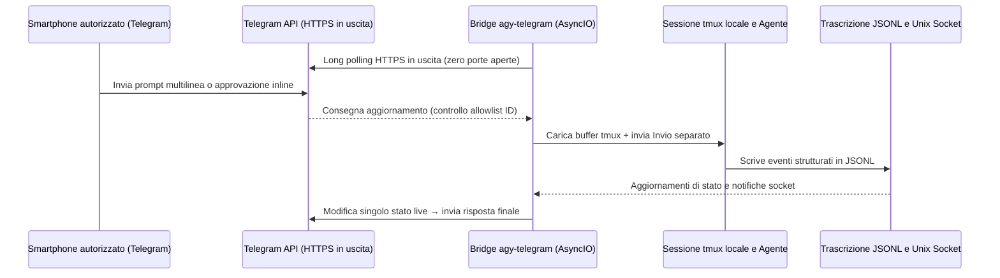

## Lasciare il processo dov’è, senza esporre porte

`agy-telegram` nasce da un'esigenza pratica: monitorare da telefono una sessione di un agente di coding già attiva, approvare passaggi e inviare nuovi prompt **senza spostare il processo fuori da `tmux`** e **senza aprire alcuna porta in ingresso** sul router o sul firewall.

Il bridge asincrono in Python (`AsyncIO`) interroga Telegram esclusivamente tramite **long polling HTTPS in uscita** e controlla ogni messaggio contro una **allowlist rigida di User ID** prima di interagire con la sessione locale.

## Trattare un prompt multilinea come operazione atomica

La prima versione iniettava i prompt simulando singoli tasti verso `tmux`: bastavano codice, virgolette o più righe per spezzare l'input. Passare a un **buffer di incolla `tmux`** ha risolto il problema alla radice: il bridge carica l'intero testo nel buffer, lo incolla in modo atomico nel pannello e invia `Invio` come comando separato.

## Stato live senza intasare la chat

Un turno lungo produce decine di passaggi intermedi. Inviare un messaggio Telegram per ogni passo renderebbe la chat illeggibile da mobile. Il bridge osserva invece la **trascrizione strutturata JSONL**, aggiorna **un unico messaggio di stato** durante l'esecuzione e invia la risposta finale formattata (con eventuali pulsanti inline di approvazione) solo a turno concluso. Un **socket Unix locale** offre inoltre ad altri script e demoni un canale dedicato per inviare notifiche proattive.

## Chiarezza sul perimetro di fiducia

Eliminare le porte in ingresso riduce drasticamente la superficie esposta in rete, ma **Telegram resta parte del perimetro di fiducia**: un account in allowlist può pilotare la sessione locale e i messaggi transitano dall'infrastruttura di Telegram. Tenerlo ben presente guida quali attività ha senso gestire da mobile e quali lasciare solo in locale.

[Scheda progetto e codice di agy-telegram](/projects/proj-agy-telegram) · [Perché sono passato da tmux ANSI a JSONL](/blog/ansi-scraping-vs-structured-jsonl)
