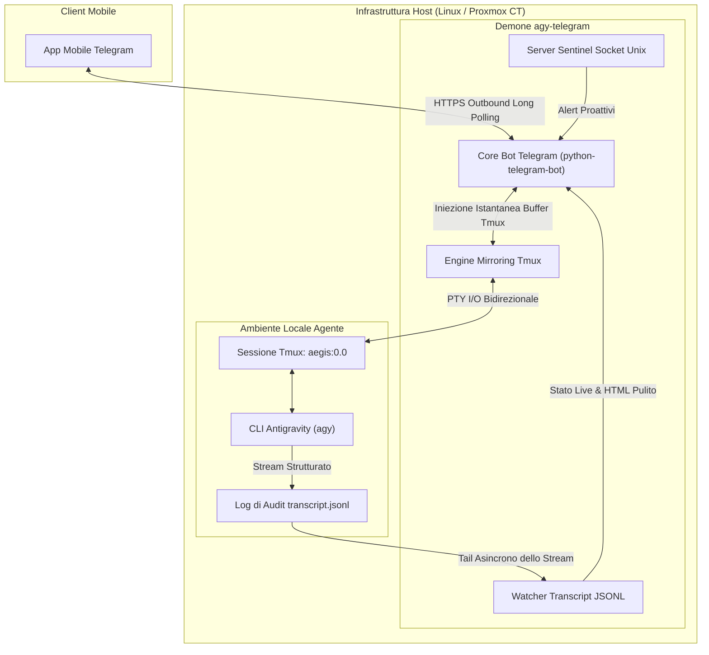

## Il Problema: Il Divario Mobile nei Sysadmin IA Autonomi

Gli agenti IA autonomi per sviluppo e sysadmin—come **Google Antigravity (`agy`)**—stanno trasformando la gestione delle infrastrutture. Dalla diagnostica bash al refactoring di repository full-stack, disporre di un agente residente nel proprio homelab o hypervisor cloud consente l'automazione continua dei flussi di lavoro.

Tuttavia, operare con questi agenti da dispositivo mobile ha sempre comportato compromessi dolorosi:
1. **SSH Mobile Nativo**: Esperienza pessima con la tastiera su schermo, disconnessioni frequenti del socket e caratteri di escape ANSI illeggibili durante la visualizzazione dei diff.
2. **Web Wrapper Insicuri**: Esporre una GUI web richiede l'apertura di porte in ingresso o l'uso di reverse proxy vulnerabili verso processi con privilegi di root.
3. **Perdita di Interattività**: La maggior parte dei bot webhook consente solo prompt unidirezionali fire-and-forget, senza possibilità di gestire approvazioni Human-in-the-Loop interattive quando l'agente richiede comandi critici (`rm -rf`, `systemctl`, `iptables`).

Per risolvere questo divario, abbiamo ingegnerizzato **[agy-telegram](https://github.com/kappino/agy-telegram)**: una mobile cockpit open-source, pronta per la produzione e concepita per un'orchestrazione sicura 1-a-1.

---

## Architettura di Sistema ad Alto Livello

`agy-telegram` agisce come un ponte bidirezionale asincrono tra il cloud Telegram e il runtime locale di Antigravity eseguito in un container Linux sicuro.



---

## 3 Innovazioni Ingegneristiche Fondamentali

### 1. Superficie di Attacco Inbound Zero & Whitelist Rigorosa 1-a-1
Anziché esporre porte aperte sul firewall o webhook in ascolto, `agy-telegram` si basa esclusivamente su long-polling HTTPS in uscita (`getUpdates`).

Al livello del gateway applicativo, qualsiasi pacchetto che non provenga dallo specifico Telegram User ID autorizzato viene scartato silenziosamente prima di raggiungere la pipeline di elaborazione:

```python
def is_authorized(self, update: Update) -> bool:
    if not update.effective_user:
        return False
    user_id = update.effective_user.id
    if user_id not in self.config.telegram.allowed_users:
        logger.warning(f"Accesso non autorizzato respinto: {user_id}")
        return False
    return True
```

### 2. Ingestione Istantanea del Prompt: Eliminazione della Latenza di Digitazione
I prototipi iniziali si basavano su `tmux send-keys -l "<prompt>"`, emulando la digitazione carattere per carattere. Con prompt complessi da 1.000 parole, questo generava secondi di latenza percepibile.

Abbiamo risolto scrivendo il prompt direttamente in un buffer temporaneo di Tmux e invocando `paste-buffer`:

```python
async def send_input(self, text: str, press_enter: bool = True):
    # Scrive istantaneamente nel buffer interno di tmux
    proc_buf = await asyncio.create_subprocess_exec("tmux", "set-buffer", "-b", "agy_input", text)
    await proc_buf.wait()

    # Incolla il buffer nella console target a latenza 0ms
    proc_paste = await asyncio.create_subprocess_exec("tmux", "paste-buffer", "-b", "agy_input", "-t", self.target)
    await proc_paste.wait()

    if press_enter:
        proc_enter = await asyncio.create_subprocess_exec("tmux", "send-keys", "-t", self.target, "Enter")
        await proc_enter.wait()
```

### 3. UX a Messaggio Singolo Dinamico con Approvazioni Interattive
Per non intasare la chat con notifiche effimere, `agy-telegram` crea un **singolo messaggio** per turno:
1. Inizia con `💭 Elaborazione in corso...`.
2. Quando l'agente esegue tool, modifica il messaggio sul posto mostrando azioni di alto livello (`⚡ Azione: <summary>`) e anteprime compatte (`<pre><code>...</code></pre>`).
3. Se l'agente richiede permessi di sicurezza, il messaggio si trasforma *sul posto* in un prompt interattivo con pulsanti inline `[ ✅ Approva ]` e `[ ❌ Rifiuta ]`.
4. Una volta prodotto l'output finale, il messaggio di stato viene eliminato in modo pulito, lasciando solo la risposta definitiva formattata con evidenziazione del codice.

---

## Alert Proattivi tramite Unix Domain Socket

Oltre a rispondere ai messaggi, `agy-telegram` fornisce un'utility CLI locale, `agy-notify`, che permette a script di monitoraggio, cron job e sistemi SIEM (come Fail2ban o Splunk) di inviare alert immediati su Telegram:

```bash
# Invio alert da script di sicurezza
agy-notify --level alert \
           --title "Alert SIEM" \
           --message "Attacco brute-force rilevato su CT 120 (Storage Hub). Soglia superata: 15 tentativi falliti in 60s."
```

---

## Conclusioni & Disponibilità Open Source

`agy-telegram` dimostra che la gestione mobile di infrastrutture server complesse non richiede compromessi tra velocità, sicurezza ed ergonomia per lo sviluppatore.

Il codice sorgente completo, inclusi i file di configurazione per servizi Systemd e i test unitari, è disponibile su GitHub con licenza open-source MIT:
👉 **[kappino/agy-telegram](https://github.com/kappino/agy-telegram)**
