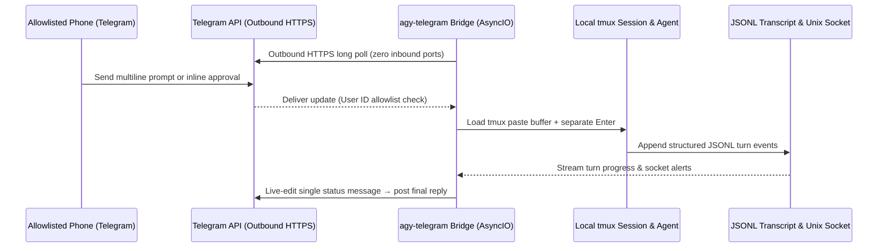

## Keep the process where it already lives

`agy-telegram` grew out of a concrete workflow friction: I wanted to check on a running local coding-agent session from my phone, review tool actions, and send follow-up prompts **without killing or wrapping the existing `tmux` session** and **without opening an inbound port** on my router or firewall.

The Python AsyncIO bridge polls Telegram exclusively over **outbound HTTPS long polling** and validates every incoming sender against an explicit Telegram User ID allowlist before touching the local workspace.

## Treating a multiline prompt as one atomic operation

An early prototype forwarded messages into `tmux` as simulated keystrokes. That broke immediately on code snippets, quotes, and multiline instructions. Switching to a **`tmux` paste buffer** fixed the reliability problem: the bridge loads the entire prompt into the buffer, pastes it atomically into the target pane, and sends `Enter` as a separate explicit action.

## Live status without chat spam

Long agent turns emit dozens of intermediate tool calls. Flooding Telegram with one message per step makes mobile review unusable. Instead, the bridge tails the structured **JSONL transcript**, live-edits **one single status message** while the turn is running, and delivers a cleanly sanitized final reply (with inline approval buttons when needed) once the turn completes. A local **Unix domain socket** lets external scripts or daemons push proactive notifications through the same bot.

## Being explicit about the trust boundary

Eliminating inbound ports reduces network exposure, but **Telegram remains inside the trust boundary**: any allowlisted account can drive the local session, and prompt/reply content transits Telegram's infrastructure. Understanding that boundary is what guides which tasks belong on mobile versus directly on the workstation.

[agy-telegram project & source code](/projects/proj-agy-telegram) · [Why I replaced ANSI scraping with JSONL](/blog/ansi-scraping-vs-structured-jsonl)
