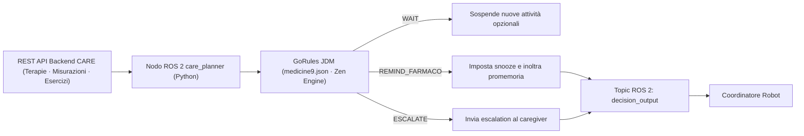

## Quando un farmaco scade durante un esercizio cognitivo

Immaginiamo un robot di assistenza domiciliare impegnato in un esercizio cognitivo su tablet mentre scatta l'orario di un farmaco. Entrambe le attività competono per l'attenzione della stessa persona — e se il promemoria viene ignorato oltre la soglia prevista, occorre avvisare il caregiver.

Durante la borsa di ricerca sul **Progetto CARE (PNRR Age-IT, con Protom Robotics)** all'Università Parthenope, oltre alla selezione dei dispositivi indossabili, alla documentazione tecnica e ai test del dimostratore, ho progettato e sviluppato da zero il nodo Python ROS 2 **`care_planner`** per gestire questo arbitraggio in modo deterministico.

## Perché sono passato da `durable_rules` a GoRules (JDM)

La prima versione funzionante del planner usava **`durable_rules`** (un motore a regole Rete integrato in Python). Dal punto di vista tecnico funzionava, ma ogni variazione alle soglie terapeutiche richiedeva di mettere mano al codice Python, rendendo le regole opache per il team clinico.

Ho quindi trasferito la logica sulle tabelle visuali **GoRules JSON Decision Model (JDM)** eseguite tramite Zen Engine. A ogni ciclo, il planner interroga le REST API del backend per raccogliere terapie, misurazioni programmate e stato della sessione cognitiva, costruisce lo snapshot di ingresso e valuta il grafo `medicine9.json`.

## Separare l'idoneità dall'orchestrazione

Dividere le responsabilità in due livelli rende il sistema molto più leggibile e verificabile:

1. **Il grafo GoRules valuta *cosa è applicabile*:**
   - la tabella farmaci controlla finestra oraria, snooze e stato in sospeso, producendo `REMIND_FARMACO` nella finestra attiva oppure `ESCALATE` a scadenza superata;
   - in parallelo, la tabella esercizi restituisce `WAIT` se un esercizio è già in corso;
   - un nodo di espressione raccoglie gli esiti in liste ordinate.
2. **Il nodo Python ROS 2 `care_planner` gestisce *stato e priorità*:**
   - impone la precedenza di promemoria e misurazioni sugli esercizi opzionali;
   - aggiorna snooze e contatori dei tentativi, pubblicando poi i comandi sul topic ROS 2 **`decision_output`** verso il coordinatore del robot.

## Cosa succede in un singolo ciclo

| Esito del grafo GoRules | Azione del `care_planner` |
| :--- | :--- |
| L'esercizio restituisce `WAIT` | Attende il feedback e mette in coda le attività opzionali. |
| Il farmaco restituisce `REMIND_FARMACO` | Aggiorna lo snooze e pubblica la richiesta prioritaria su `decision_output`. |
| Farmaco ancora in attesa dopo la scadenza (`ESCALATE`) | Genera un comando di escalation indirizzato all'integrazione caregiver. |

Tenere le condizioni in GoRules permette ai clinici di leggere le politiche in un editor visuale; mantenere stato e pubblicazione nel nodo Python garantisce che ogni comando inviato al robot sia deterministico e tracciabile.

[Scheda progetto e architettura di CARE](/projects/proj-care-decision-planner)
