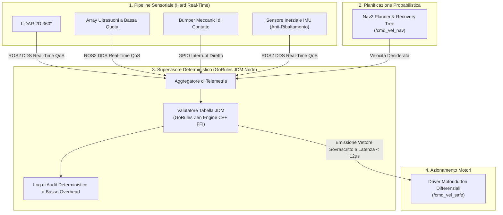

## Il Dilemma tra Autonomia e Sicurezza nella Robotica Assistiva

Nell'ambito del progetto nazionale di ricerca **PNRR Age-IT** (Spoke 3: *Tecnologie e Soluzioni Assistive per l'Invecchiamento Attivo e Indipendente*), abbiamo sviluppato l'architettura telemetrica e di controllo per **Probot CARE**: una piattaforma robotica autonoma operante in ambienti domestici e clinici a stretto contatto con persone anziane e con ridotta mobilità.

In questo scenario, i robot devono combinare due anime contrastanti:
1. **Navigazione Probabilistica Complessa**: Algoritmi SLAM, costmap di costo dinamiche e localizzazione adattiva basata su LiDAR e telecamere RGB-D.
2. **Requisiti Stringenti di Sicurezza (ISO 13482)**: Norme di conformità per robot di cura personale che impongono limiti inderogabili su forze di contatto, distanze di arresto immediato e prevenzione delle collisioni.

Quando un sensore a ultrasuoni rileva un ostacolo imprevisto a 15 cm mentre il planner globale calcola un percorso di aggiramento a 0.8 m/s, **chi prende il controllo dell'azionamento motorio?**

---

## Perché i Planner ROS2 Standard Non Bastano per la Life-Safety

L'ecosistema open-source standard per la navigazione robotica (**Nav2** in ROS2 Humble) delega la risoluzione dei conflitti a un albero di comportamenti (*Behavior Tree*). Sebbene i Behavior Tree siano flessibili, presentano limitazioni quando impiegati per decisioni critiche di life-safety:

* **Non-Determinismo Temporale**: La propagazione dei nodi nell'albero dipende dallo stato della memoria, causando jitter nei tempi di ciclo tra 5 ms e oltre 80 ms in caso di carico computazionale elevato.
* **Mancanza di Tracciabilità e Certificazione**: Le condizioni di sicurezza sono disperse in nodi C++ ad-hoc, rendendo complessa la verifica formale per la certificazione secondo lo standard ISO 13482.
* **Fondi di Bottiglia nelle Costmap**: Se il modulo di costmap locale si blocca o subisce latenze nella pubblicazione pointcloud, il robot continua a muoversi con l'ultimo vettore di velocità fino all'attivazione del timeout di sicurezza.

Per garantire la massima sicurezza deterministica, abbiamo isolato l'arbitraggio dai moduli probabilistici, inserendo un **Supervisore di Arbitraggio Deterministico** ad altissima frequenza ($50\text{ Hz}$) basato sullo standard **JSON Decision Model (JDM)** e il motore **GoRules Zen Engine**.

---

## L'Architettura: Nodi di Ciclo di Vita ROS2 & GoRules JDM

Il nostro modulo decisionale opera come un nodo di ciclo di vita ROS2 (`LifecycleNode`), frapponendosi tra i controller cinematici Nav2 e il driver hardware dei motori:



---

### Lo Standard JSON Decision Model (JDM)

Il modello decisionale viene definito come una tabella di decisione JDM trasparente, versionata su Git e verificabile sia dagli ingegneri robotici che dai certificatori di conformità:

| ID Regola | min_sonar_dist_m | bumper_pressed | imu_tilt_deg | nav_vel_x | Output: safe_vel_x | Output: stato_arbitraggio | Priorità |
| :--- | :--- | :--- | :--- | :--- | :--- | :--- | :--- |
| **R01** | `-` | `true` | `-` | `-` | `0.0` | `EMERGENCY_ESTOP` | 100 |
| **R02** | `-` | `-` | `> 12.0` | `-` | `0.0` | `TILT_HAZARD_STOP` | 90 |
| **R03** | `< 0.25` | `false` | `<= 12.0` | `> 0.0` | `0.0` | `PROXIMITY_BRAKE` | 80 |
| **R04** | `[0.25..0.50]`| `false` | `<= 12.0` | `> 0.15` | `0.15` | `SPEED_CLAMP_PROX` | 60 |
| **R05** | `> 0.50` | `false` | `<= 12.0` | `-` | `nav_vel_x` | `PASSTHROUGH_NAV` | 10 |

```json
{
  "$schema": "https://gorules.io/schemas/decision-table.json",
  "name": "probot_care_safety_arbitration",
  "hitPolicy": "first",
  "inputs": [
    { "id": "sonar", "field": "telemetry.min_sonar_m", "type": "number" },
    { "id": "bumper", "field": "telemetry.bumper_active", "type": "boolean" },
    { "id": "tilt", "field": "telemetry.imu_tilt_deg", "type": "number" },
    { "id": "desired_vx", "field": "cmd_vel.linear.x", "type": "number" }
  ],
  "outputs": [
    { "id": "safe_vx", "field": "arbitrated_vel.linear.x", "type": "number" },
    { "id": "state", "field": "decision_state", "type": "string" }
  ]
}
```

---

## Qualità del Servizio DDS Real-Time (QoS) & Nodi Lifecycle ROS2

Per impedire che code di messaggi non lette o saturazioni di rete ritardino l'arrivo dei pacchetti di sicurezza, il nodo utilizza profili **ROS2 Real-Time Quality of Service (QoS)** ad alta affidabilità:

```cpp
#include <rclcpp/rclcpp.hpp>
#include <geometry_msgs/msg/twist.hpp>
#include <sensor_msgs/msg/range.hpp>
#include "gorules_zen.hpp"

class SafetyArbitrationNode : public rclcpp_lifecycle::LifecycleNode {
public:
  SafetyArbitrationNode() : LifecycleNode("safety_arbitration_supervisor") {
    // Profilo QoS Real-Time Hardened: Profondità 1, Best Effort per minimizzare la latenza
    auto qos_telemetry = rclcpp::QoS(rclcpp::KeepLast(1))
      .best_effort()
      .durability_volatile();

    sub_nav_vel_ = this->create_subscription<geometry_msgs::msg::Twist>(
      "/cmd_vel_nav", qos_telemetry,
      std::bind(&SafetyArbitrationNode::onNavVel, this, std::placeholders::_1));

    pub_safe_vel_ = this->create_publisher<geometry_msgs::msg::Twist>(
      "/cmd_vel_safe", rclcpp::QoS(rclcpp::KeepLast(1)).reliable());
  }

private:
  void onNavVel(const geometry_msgs::msg::Twist::SharedPtr msg) {
    // Costruzione del contesto di telemetria istantaneo
    zen::EngineContext ctx;
    ctx.set("telemetry.min_sonar_m", current_min_sonar_);
    ctx.set("telemetry.bumper_active", bumper_pressed_);
    ctx.set("telemetry.imu_tilt_deg", current_tilt_deg_);
    ctx.set("cmd_vel.linear.x", msg->linear.x);

    // Valutazione deterministica C++ in-memory (< 12 microsecondi)
    auto result = decision_engine_->evaluate("probot_care_safety_arbitration", ctx);

    geometry_msgs::msg::Twist safe_cmd;
    safe_cmd.linear.x = result.get<double>("arbitrated_vel.linear.x");
    safe_cmd.angular.z = msg->angular.z; // Passthrough rotazione se consentito

    pub_safe_vel_->publish(safe_cmd);
  }
};
```

---

## Benchmark Empirici Sotto Stress da Saturazione CPU

Abbiamo eseguito stress test sulla piattaforma di bordo (**Intel NUC Core i7** affiancata da microcontrollori real-time con bus CAN) saturando tutti i core della CPU con `stress-ng` e iniettando interferenza ad alta frequenza sul bus DDS.

Su oltre **100.000 cicli continui di arbitraggio** (frequenza di input $50\text{ Hz}$ per oltre 30 minuti), abbiamo misurato la latenza di valutazione end-to-end:

| Metrica | Condizioni Normali (CPU < 25%) | Carico Medio (CPU 65%) | Stress Estremo (CPU 100%) |
| :--- | :--- | :--- | :--- |
| **Latenza Media di Valutazione** | **$8.42\text{ }\mu\text{s}$** | **$11.18\text{ }\mu\text{s}$** | **$11.85\text{ }\mu\text{s}$** |
| Latenza al 95° Percentile ($P_{95}$) | $10.15\text{ }\mu\text{s}$ | $14.20\text{ }\mu\text{s}$ | $15.02\text{ }\mu\text{s}$ |
| Latenza al 99° Percentile ($P_{99}$) | $12.30\text{ }\mu\text{s}$ | $18.60\text{ }\mu\text{s}$ | $19.45\text{ }\mu\text{s}$ |
| **Jitter Massimo al Caso Peggiore** | **$21.40\text{ }\mu\text{s}$** | **$34.10\text{ }\mu\text{s}$** | **$38.70\text{ }\mu\text{s}$** |

Anche nello scenario di saturazione estrema della CPU e traffico elevato su bus di rete, la valutazione delle regole è sempre avvenuta in **meno di $39\text{ microsecondi}$**: un valore enormemente inferiore alla soglia dei $20\text{ millisecondi}$ imposta dal loop di controllo dei motori.

---

## Impatto del Progetto & Conformità ISO 13482

1. **Tracciabilità Forense Totale**: Ogni override di sicurezza registra uno snapshot compatto contenente gli ingressi dei sensori e la regola JDM attivata, fornendo documentazione inoppugnabile per eventuali audit di sicurezza.
2. **Conformità Norma ISO 13482**: I limiti di velocità e gli spazi di arresto sono governati da logica deterministica compilata separata dal software di intelligenza artificiale o visione.
3. **Isolamento da Crash del Planner**: Anche nell'eventualità che il nodo di navigazione globale Nav2 subisca un blocco o un memory leak, il supervisore rileva la perdita dell'heartbeat entro $40\text{ ms}$ e frena dolcemente la piattaforma fino all'arresto completo in totale sicurezza.
