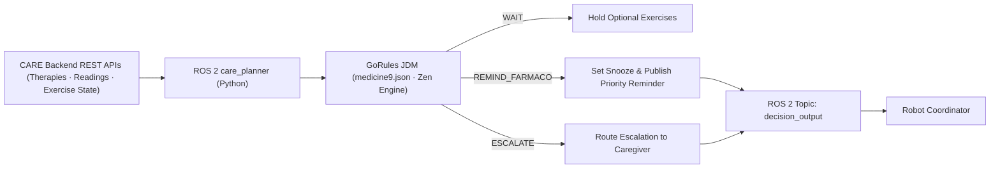

## When a medication reminder collides with an active exercise

Imagine a home-assistance robot helping an older adult with a tablet-based cognitive exercise when a scheduled medication reminder comes due. Both activities compete for the same person's attention — and if the reminder is repeatedly ignored, a caregiver needs to be notified.

During my research fellowship on **Project CARE (PNRR Age-IT, with Protom Robotics)** at the University of Naples Parthenope, I selected biomedical wearables, documented and tested the demonstrator, and designed and built the Python ROS 2 **`care_planner`** node from scratch to solve this exact arbitration problem.

## Why I moved from `durable_rules` to GoRules (JDM)

My first working implementation of `care_planner` ran on **`durable_rules`** (a Rete forward-chaining engine embedded in Python). Technically it worked, but every policy tweak required editing Python rule code — creating an opaque wall between developers and the clinicians designing care protocols.

To make policies inspectable and maintainable by non-technical stakeholders, I transferred the rule logic into **GoRules JSON Decision Model (JDM)** tables evaluated via Zen Engine. For the demonstrator, the planner pulls live therapy schedules, biometric measurement plans, and active exercise state from the backend REST APIs, formats the snapshot, and evaluates the `medicine9.json` decision graph on every cycle.

## Splitting eligibility from orchestration

A clean architectural boundary makes the system far easier to debug and audit:

1. **GoRules JDM decides *eligibility*:**
   - The medication table checks schedule windows, snooze offsets, and pending flags — emitting `REMIND_FARMACO` inside the reminder window or `ESCALATE` once the deadline passes with no confirmation.
   - Independently, the exercise table returns `WAIT` if a cognitive session is already running.
   - An expression node collects branch outputs into structured lists.
2. **The Python ROS 2 `care_planner` handles *state & arbitration*:**
   - Applies priority precedence so medication reminders and health measurements override optional exercises.
   - Updates snooze offsets and retry counters cleanly in Python, then publishes explicit commands to the robot coordinator on the **`decision_output`** ROS 2 topic.

## Walking through a single evaluation cycle

| GoRules graph output | How `care_planner` responds |
| :--- | :--- |
| Exercise returns `WAIT` | Holds new optional activities and waits for session feedback. |
| Medication returns `REMIND_FARMACO` | Updates the snooze offset and queues the reminder on `decision_output`. |
| Unconfirmed medication past deadline returns `ESCALATE` | Emits an escalation command targeting the caregiver integration. |

Keeping eligibility declarative inside GoRules lets clinicians read every threshold in one visual table, while keeping state transitions and ROS 2 publication in Python makes every published robot command deterministic and traceable.

[CARE project case study & architecture](/projects/proj-care-decision-planner)
