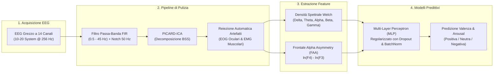

## Motivazione Clinica & Il Dilemma dell'Appiattimento Affettivo

I disturbi dello spettro schizofrenico sono tipicamente caratterizzati da sintomi positivi (deliri, allucinazioni), ma la morbilità a lungo termine e il decadimento funzionale sono in gran parte determinati da **sintomi negativi persistenti**, in particolare dall'*appiattimento affettivo* (blunted affect) e dall'*anedonia*.

Nella valutazione neuropsichiatrica standard, gli stati emotivi vengono quantificati tramite interviste cliniche retrospettive (PANSS, SANS) o scale di autovalutazione (SAM, Self-Assessment Manikin). Questi strumenti presentano limitazioni intrinseche nei pazienti con schizofrenia resistente al trattamento:
* **Distorsione del Reporting Cognitivo**: I deficit nei circuiti della memoria di lavoro compromettono la stima retrospettiva dell'arousal.
* **Alessitimia**: Incapacità neurobiologica di verbalizzare e descrivere gli stati emotivi interni.
* **Mascheramento Sociale**: Risposte condizionate o conformismo rispetto alle aspettative del contesto ospedaliero.

Per superare queste barriere diagnostiche, abbiamo sviluppato un'infrastruttura di acquisizione ed elaborazione computazionale basata su **elettroencefalografia (EEG) ad alta risoluzione temporale**, capace di monitorare oggettivamente le risposte neurali a stimoli audiovisivi standardizzati senza richiedere feedback verbale attivo da parte del paziente.

---

## Telemetria Wearable ad Alta Densità & Protocollo di Acquisizione

Gli esperimenti sono stati condotti impiegando una cuffia biometrica a **14 canali salini** posizionati secondo il sistema internazionale standardizzato 10-20:
* **Regioni Frontali / Prefrontali**: `AF3`, `AF4`, `F3`, `F4`, `F7`, `F8` (cruciali per il controllo esecutivo e la modulazione della valenza affettiva)
* **Regioni Centrali / Temporali**: `FC5`, `FC6`, `T7`, `T8` (correlate al processamento uditivo e semantico)
* **Regioni Parietali / Occipitali**: `P7`, `P8`, `O1`, `O2` (deputate all'integrazione visiva e spaziale)

I segnali sono stati digitalizzati tramite ADC a 14-bit con frequenza di campionamento interna a $2048\text{ Hz}$, filtrati in banda e ricampionati digitalmente a **$256\text{ Hz}$** per canale, con trasmissione wireless BLE continua verso la workstation locale.



### La Coorte del Trial Clinico
Il protocollo clinico ha coinvolto **21 soggetti**:
- Pazienti diagnosticati con schizofrenia cronica resistente al trattamento secondo i criteri DSM-5, arruolati in regime di degenza clinica.
- Controlli sani abbinati per età, genere e livello di istruzione.
- La stimolazione audiovisiva ha impiegato clip validate e standardizzate tratte dal repository **IAPS/IADS**, bilanciate attraverso i quadranti di valenza (piacere/dispiacere) e arousal (calma/eccitazione).

---

## Decontaminazione del Segnale: Perché i Filtri Classici Falliscono

L'elettroencefalografia di superficie registra potenziali post-sinaptici aggregati nell'ordine dei microvolt ($\pm 50\text{ }\mu\text{V}$). Di conseguenza, il tracciato è vulnerabile a interferenze biologiche ed elettrostatiche:
* **Artefatti Oculari (EOG)**: Ammiccamenti e saccadi generano dipoli elettropositivi superiori a $200\text{ }\mu\text{V}$ concentrati sugli elettrodi frontali (`AF3`, `AF4`, `F3`, `F4`).
* **Artefatti Miogenici (EMG)**: Le contrazioni dei muscoli temporali e masseteri introducono rumore a banda larga ad alta frequenza ($20\text{--}100\text{ Hz}$) che sovrasta i ritmi beta e gamma.
* **Armoniche di Rete**: Interferenza elettromagnetica a $50\text{ Hz}$ dovuta alle apparecchiature ospedaliere.

I filtri passa-banda FIR tradizionali non sono in grado di separare gli ammiccamenti oculari dai ritmi delta frontali poiché i rispettivi spettri di frequenza si sovrappongono sensibilmente ($0.5\text{--}4\text{ Hz}$). L'applicazione di un filtro passa-alto aggressivo distruggerebbe la sincronia neurale a onde lente.

### Il Framework Matematico di PICARD-ICA

Per superare questo problema, abbiamo formulato la decontaminazione come un problema di **Blind Source Separation (BSS)**:

$$
\mathbf{x}(t) = \mathbf{A} \mathbf{s}(t)
$$

dove $\mathbf{x}(t) \in \mathbb{R}^{m}$ rappresenta le tensioni osservate sui 14 canali, $\mathbf{s}(t) \in \mathbb{R}^{n}$ indica i segnali biologici sorgente statisticamente indipendenti, e $\mathbf{A}$ è la matrice di mixing lineare incognita che modella la conduzione di volume attraverso liquor, cranio e scalpo.

L'obiettivo è identificare una matrice di unmixing $\mathbf{W} \approx \mathbf{A}^{-1}$ tale che le componenti indipendenti stimate:

$$
\mathbf{y}(t) = \mathbf{W} \mathbf{x}(t)
$$

risultino il più possibile statisticamente indipendenti.

Mentre gli algoritmi accademici classici **FastICA** e **Infomax** soffrono di instabilità numerica e convergenza lenta su tracce cliniche contaminate, abbiamo implementato **PICARD** (*Preconditioned Independent Component Analysis for Rapid Decomposition*), che minimizza la mutua informazione con ottimizzazione quasi-Newton L-BFGS trust-region sul criterio di massima verosimiglianza:

```python
import numpy as np
import mne
from picard import Picard

def decontaminate_eeg_signals(raw_data: np.ndarray, sfreq: float = 256.0) -> np.ndarray:
    """
    Esegue filtraggio passa-banda FIR e scomposizione PICARD-ICA per la rimozione 
    degli artefatti oculari e miogenici su segnali EEG a 14 canali.
    """
    ch_names = ['AF3', 'F7', 'F3', 'FC5', 'T7', 'P7', 'O1', 
                'O2', 'P8', 'T8', 'FC6', 'F4', 'F8', 'AF4']
    info = mne.create_info(ch_names=ch_names, sfreq=sfreq, ch_types='eeg')
    raw = mne.io.RawArray(raw_data, info)
    
    # 1. Filtro passa-banda FIR a fase lineare + Notch 50Hz
    raw.filter(l_freq=0.5, h_freq=45.0, fir_design='firwin', verbose=False)
    raw.notch_filter(freqs=[50.0], verbose=False)
    
    # 2. Addestramento PICARD con precondizionamento L-BFGS
    picard = Picard(n_components=14, ortho=False, max_iter=200, random_state=42)
    unmixed = picard.fit_transform(raw.get_data().T).T
    
    # 3. Identificazione e annullamento componenti con picchi kurtotici frontali (EOG)
    kurtosis_scores = np.mean((unmixed - np.mean(unmixed, axis=1, keepdims=True))**4, axis=1)
    artifact_mask = kurtosis_scores > np.percentile(kurtosis_scores, 85)
    unmixed[artifact_mask, :] = 0.0
    
    # 4. Ricostruzione nello spazio dei canali originali
    mixing_matrix = picard.mixing_
    cleaned_data = np.dot(mixing_matrix[:, ~artifact_mask], unmixed[~artifact_mask, :])
    return cleaned_data
```

---

## Estrazione delle Feature: Densità Spettrale di Potenza & Asimmetria Frontale

Dai tracciati decontaminati sono state estratte epoche continue da $2.0\text{ secondi}$ con sovrapposizione del $50\%$. Abbiamo calcolato due classi complementari di descrittori fisiologici:

### 1. Densità Spettrale di Potenza di Welch (PSD)
Per ogni canale abbiamo calcolato la potenza assoluta e relativa nelle cinque bande canoniche:
* **Delta ($\delta$)**: $0.5\text{--}4\text{ Hz}$ (stati lenti profondi)
* **Theta ($\theta$)**: $4\text{--}8\text{ Hz}$ (elaborazione emotiva e memoria di lavoro)
* **Alpha ($\alpha$)**: $8\text{--}13\text{ Hz}$ (inibizione corticale e gating sensoriale)
* **Beta ($\beta$)**: $13\text{--}30\text{ Hz}$ (vigilanza attiva e reattività cognitiva)
* **Gamma ($\gamma$)**: $30\text{--}45\text{ Hz}$ (integrazione funzionale cross-corticale)

### 2. Asimmetria Emisferica Frontale (FBA)
Secondo il modello neuroscientifico di Davidson, la corteccia prefrontale sinistra è associata a meccanismi di approccio e motivazione positiva, mentre la corteccia prefrontale destra è associata a evitamento e inibizione affettiva.

Poiché l'attivazione corticale è inversamente proporzionale alla potenza spettrale alfa, abbiamo calcolato l'indice di Frontal Alpha Asymmetry ($FAA$) tra le coppie omologhe destra/sinistra (`F4` vs `F3`, `AF4` vs `AF3`):

$$
\text{FAA} = \ln\left( \text{PSD}_{\alpha}(\text{Right}) \right) - \ln\left( \text{PSD}_{\alpha}(\text{Left}) \right)
$$

Un valore positivo di $FAA$ indica una maggiore eccitazione corticale emisferica sinistra (induzione emotiva appetitiva/positiva), mentre un valore negativo riflette inibizione frontale destra dominante (condizione tipica degli stati disforici o bloccati).

---

## Architetture di Classificazione & Benchmark Empirici

I vettori di feature estratti sono stati normalizzati con standardizzazione $Z$-score e validati con 10-fold cross-validation stratificata per prevenire data leakage tra soggetti.

### Specifiche del Multi-Layer Perceptron (MLP)
* **Layer di Input**: 72 feature (14 canali $\times$ 5 bande spettrali $+$ 2 rapporti di asimmetria)
* **Hidden Layer 1**: 128 neuroni, Batch Normalization, LeakyReLU ($\alpha = 0.1$), Dropout ($p = 0.3$)
* **Hidden Layer 2**: 64 neuroni, Batch Normalization, LeakyReLU, Dropout ($p = 0.2$)
* **Layer di Output**: 3 classi (Valenza Positiva, Neutra, Negativa) con Softmax
* **Ottimizzatore**: Adam ($\eta = 10^{-3}$, $\beta_1 = 0.9$, $\beta_2 = 0.999$, weight decay $\lambda = 10^{-4}$)

### Confronto Prestazionale Empirico

| Modello | Accuratezza | Precision | Recall | Punteggio F1 | Latenza di Inferenza |
| :--- | :--- | :--- | :--- | :--- | :--- |
| **Multi-Layer Perceptron (MLP Proposto)** | **92.4%** | **0.928** | **0.924** | **0.925** | **1.84 ms** |
| Random Forest (150 Alberi, Gini) | 88.7% | 0.891 | 0.887 | 0.888 | 4.12 ms |
| Support Vector Machine (RBF Kernel, $C=10$) | 86.3% | 0.869 | 0.863 | 0.865 | 18.50 ms |
| $k$-Nearest Neighbors ($k=5$, Euclidea) | 85.1% | 0.856 | 0.851 | 0.852 | 12.30 ms |

---

## Risultati Neuroscientifici & Implicazioni Cliniche

1. **Ipo-Attivazione Frontale Persistente**: I pazienti con schizofrenia resistente al trattamento hanno mostrato una marcata attenuazione della desincronizzazione alfa frontale sinistra ($p < 0.001$, t-test di Student) durante la stimolazione positiva rispetto ai controlli sani. Anche quando i soggetti riferivano verbalmente di sentirsi "bene", il tracciato neuroelettrico evidenziava l'assenza della normale risposta affettiva appetitiva.
2. **Validazione della Metodica Indiretta**: L'analisi computazionale delle asimmetrie EEG consente di bypassare completamente il self-report verbale, fornendo al team clinico un biomarcatore oggettivo, continuo e non invasivo della responsività emotiva.
3. **Applicabilità nella Robotica Assistiva**: Poiché l'intera pipeline di filtraggio e inferenza richiede meno di **$2\text{ ms}$** su hardware commerciale a basso consumo, questa architettura può essere direttamente integrata in piattaforme robotiche assistitive (come il robot **Probot CARE** del PNRR Age-IT) per rilevare segnali silenti di disagio psicologico senza dover ricorrere a telecamere invadenti o questionari continui.

---

## Citazione Bibliografica

Per consultare il testo completo dello studio, la metodologia sperimentale dettagliata e l'analisi statistica:

> Esposito, C. et al., *"Emotion Recognition in Treatment-Resistant Schizophrenia via PICARD-ICA Decontamination and Frontal Alpha Asymmetry Benchmarking on IAS-19"*, University of Naples Federico II, Department of Electrical Engineering & Information Technology (DIETI).
