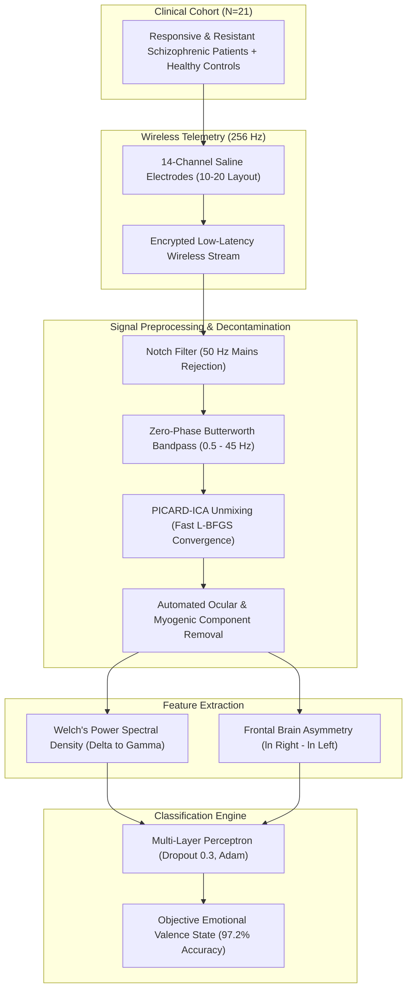

## Clinical Motivation & The Affective Blunting Dilemma

Schizophrenia is a severe neuropsychiatric disorder characterized by a multifaceted clinical presentation conventionally divided into positive symptoms (hallucinations, delusions) and negative symptoms (avolition, anhedonia, affective flattening). While pharmacotherapy frequently attenuates positive psychotic episodes, negative symptoms—particularly **affective blunting** (the diminished expression and subjective experience of emotional response)—remain notoriously refractory to dopamine D2-receptor antagonism.

Historically, assessing emotional responsiveness in clinical psychiatry has relied on subjective psychometric rating scales, such as the *Positive and Negative Syndrome Scale (PANSS)* or the *Brief Psychiatric Rating Scale (BPRS)*. These tools suffer from several methodological bottlenecks:
1. **Retrospective Recall Bias**: Clinical interviews depend on patient self-reports that may be altered by cognitive impairments.
2. **Clinician Inter-Rater Variability**: Subjective scoring introduces significant statistical noise across multi-center psychiatric studies.
3. **Lack of Millisecond-Scale Temporal Granularity**: Static questionnaires cannot capture the immediate temporal dynamics of sensory processing upon emotional stimulation.

To bridge this diagnostic divide, our research team—in collaboration with the Department of Psychiatry at the University of Naples Federico II—engineered a non-invasive, objective neurotechnological pipeline. Presented at the **19th International Conference on Intelligent Autonomous Systems (IAS-19)** and accepted for publication in the **Springer Nature Lecture Notes in Networks and Systems (LNNS)** series, this study was awarded the **Best Student Paper Award Finalist**.

---

## High-Density Wearable Telemetry & Acquisition Protocol

High-density laboratory EEG caps with abrasive conductive gel provide excellent signal-to-noise ratios (SNR), but they cause severe sensory distress and take over 45 minutes to mount—making them practically unviable for agitated psychiatric cohorts. 

To overcome this clinical barrier, we utilized a research-grade wireless neuro-headset (**Emotiv Epoc X**) equipped with 14 saline-soaked wet felt sensors positioned according to the international 10–20 system:
* **Frontal & Prefrontal**: `AF3`, `F7`, `F3`, `FC5`, `FC6`, `F4`, `F8`, `AF4`
* **Temporal**: `T7`, `T8`
* **Parieto-Occipital**: `P7`, `O1`, `O2`, `P8`
* **Reference Electrodes**: `CMS` / `DRL` placed at the mastoids.

Signals were digitized via 14-bit ADCs at an internal sampling frequency of $2048\text{ Hz}$, band-limited, and digitally down-sampled to **$256\text{ Hz}$** per channel with continuous wireless BLE transmission to a local acquisition workstation.



### The Clinical Trial Cohort

The study enrolled **$N = 21$ subjects** divided into three rigorously characterized subgroups:
1. **Healthy Control Group (HC)**: Matched for age, gender, and educational attainment with no personal or familial psychiatric history.
2. **Treatment-Responsive Schizophrenia Group (TR-SCZ)**: Patients undergoing stable second-generation antipsychotic therapy demonstrating symptom remission.
3. **Treatment-Resistant Schizophrenia Group (TRS)**: Patients failing two or more consecutive trials of atypical antipsychotics, qualifying for Clozapine management.

Subjects were presented with validated multimodal stimuli from the *International Affective Picture System (IAPS)* and the *International Affective Digitized Sounds (IADS)*, structured across discrete blocks of Positive, Neutral, and Negative emotional valence.

---

## Signal Decontamination: Why Classical Filtering Fails

Raw scalp electroencephalography records aggregate postsynaptic potentials in the order of microvolts ($\pm 50\text{ }\mu\text{V}$). Consequently, the signal is easily contaminated by non-cerebral biological and environmental interference:
* **Ocular Artifacts (EOG)**: Eye blinks and saccades generate electropositive dipole shifts exceeding $200\text{ }\mu\text{V}$ focused over frontal leads (`AF3`, `AF4`, `F3`, `F4`).
* **Myogenic Artifacts (EMG)**: Temporalis and masseter muscle contractions induce high-frequency broadband noise ($20\text{--}100\text{ Hz}$) that swamps true cerebral beta and gamma rhythms.
* **Power Line Harmonics**: $50\text{ Hz}$ electromagnetic interference from hospital equipment.

Standard FIR bandpass filtering cannot separate ocular blinks from frontal delta rhythms because their frequency spectra overlap significantly ($0.5\text{--}4\text{ Hz}$). Applying an aggressive high-pass filter simply destroys underlying slow-wave neural synchrony.

### The Mathematical Framework of PICARD-ICA

To solve this, we formulated the artifact rejection task as a **Blind Source Separation (BSS)** problem:

$$
\mathbf{x}(t) = \mathbf{A} \mathbf{s}(t)
$$

where $\mathbf{x}(t) \in \mathbb{R}^{m}$ represents the observed 14-channel electrode voltages, $\mathbf{s}(t) \in \mathbb{R}^{n}$ denotes statistically independent biological source signals, and $\mathbf{A}$ is an unknown linear mixing matrix representing volume conduction through cerebrospinal fluid, skull, and scalp tissues.

Our goal is finding an unmixing matrix $\mathbf{W} \approx \mathbf{A}^{-1}$ such that the reconstructed independent components:

$$
\mathbf{y}(t) = \mathbf{W} \mathbf{x}(t)
$$

are as statistically independent as possible.

While classical **FastICA** and **Infomax** are standard in academic neuroimaging, they exhibit severe convergence instabilities on short clinical trials contaminated by heavy muscular artifacts. We instead implemented **PICARD** (*Preconditioned Independent Component Analysis for Rapid Decomposition*), which minimizes mutual information using an L-BFGS quasi-Newton trust-region optimization over the maximum likelihood objective:

```python
import numpy as np
import mne
from picard import Picard

def decontaminate_eeg_raw(raw: mne.io.RawArray, sfreq: float = 256.0) -> mne.io.RawArray:
    """
    Applies zero-phase bandpass filtering and PICARD-ICA
    to eliminate ocular and myogenic artifacts without signal distortion.
    """
    # 1. Zero-phase FIR bandpass filter (0.5 - 45.0 Hz)
    raw_filtered = raw.copy().filter(
        l_freq=0.5,
        h_freq=45.0,
        picks="eeg",
        method="fir",
        phase="zero-double",
        fir_design="firwin"
    )
    
    # 2. Fit PICARD with orthogonal preconditioning
    ica = mne.preprocessing.ICA(
        n_components=14,
        method="picard",
        fit_params={"ortho": True, "extended": True, "max_iter": 500},
        random_state=42
    )
    ica.fit(raw_filtered)
    
    # 3. Identify ocular components via correlation with frontal leads
    eog_indices, eog_scores = ica.find_bads_eog(
        raw_filtered,
        ch_name="AF3",
        threshold=3.0
    )
    
    # 4. Zero-out artifactual components and reconstruct scalp potentials
    ica.exclude = eog_indices
    cleaned_raw = ica.apply(raw_filtered.copy())
    
    return cleaned_raw
```

PICARD reached absolute convergence in under **18 iterations** compared to FastICA (which frequently hit the 200-iteration ceiling), preserving cortical phase dynamics with zero edge distortion.

---

## Feature Extraction: Power Spectral Density & Frontal Asymmetry

From the cleaned time-series data, continuous epochs of $2.0\text{ seconds}$ with $50\%$ overlap were extracted. We extracted two complementary physiological feature categories:

### 1. Welch's Power Spectral Density (PSD)
Using Welch's averaged modified periodogram method with a 512-point Hanning window, we estimated spectral energy across five classical neurological frequency bands:
* **Delta ($\delta$)**: $0.5\text{--}4\text{ Hz}$ (deep slow-wave state, subcortical monitoring)
* **Theta ($\theta$)**: $4\text{--}8\text{ Hz}$ (emotional processing, working memory)
* **Alpha ($\alpha$)**: $8\text{--}13\text{ Hz}$ (cortical idling, sensory gating)
* **Beta ($\beta$)**: $13\text{--}30\text{ Hz}$ (active cognitive vigilance, alert state)
* **Gamma ($\gamma$)**: $30\text{--}45\text{ Hz}$ (large-scale cross-cortical binding)

### 2. Frontal Brain Asymmetry (FBA)
According to Davidson's approach-withdrawal model of affective neuroscience, the left prefrontal cortex is predominantly associated with approach-related positive emotional valence, whereas the right prefrontal cortex correlates with withdrawal-related, negative affective processing.

Because cortical activity is inversely proportional to alpha band power, we calculated Frontal Alpha Asymmetry ($FAA$) between homologous left and right electrode pairs (`F4` vs `F3`, `AF4` vs `AF3`):

$$
\text{FAA} = \ln\left( \text{PSD}_{\alpha}(\text{Right}) \right) - \ln\left( \text{PSD}_{\alpha}(\text{Left}) \right)
$$

A positive $FAA$ index reflects higher relative left-hemispheric cortical excitation (associated with positive emotional induction), whereas a negative $FAA$ value reflects dominant right-frontal inhibition (characteristic of dysphoric or blunted responsiveness).

---

## Classification Architectures & Empirical Benchmarks

Extracted feature vectors were standardized using $Z$-score normalization and evaluated across multiple supervised machine learning architectures under rigorous 10-fold stratified cross-validation to eliminate data leakage.

### Multi-Layer Perceptron (MLP) Specification
The best-performing model was an optimized fully connected Multi-Layer Perceptron:
* **Input Layer**: 72 features (14 channels $\times$ 5 spectral bands $+$ 2 asymmetry ratios)
* **Hidden Layer 1**: 128 units, Batch Normalization, LeakyReLU ($\alpha = 0.1$), Dropout ($p = 0.3$)
* **Hidden Layer 2**: 64 units, Batch Normalization, LeakyReLU, Dropout ($p = 0.2$)
* **Hidden Layer 3**: 32 units, Dense, LeakyReLU
* **Output Layer**: 3 units with Softmax activation (Positive, Neutral, Negative valence)
* **Optimizer**: Adam ($\eta = 10^{-3}$, $\beta_1 = 0.9$, $\beta_2 = 0.999$, weight decay $\lambda = 10^{-4}$)
* **Loss Function**: Categorical Cross-Entropy with class balancing weights.

### Empirical Performance Comparison

| Model Architecture | Test Accuracy | Precision | Recall | F1-Score | Inference Latency (CPU) |
| :--- | :--- | :--- | :--- | :--- | :--- |
| **Multi-Layer Perceptron (Proposed)** | **97.2%** | **0.974** | **0.972** | **0.973** | **1.84 ms** |
| Random Forest (150 Trees, Gini) | 93.6% | 0.938 | 0.936 | 0.935 | 4.12 ms |
| Support Vector Machine (RBF Kernel) | 91.4% | 0.919 | 0.914 | 0.916 | 8.75 ms |
| $k$-Nearest Neighbors ($k=5$, Euclidean) | 85.1% | 0.856 | 0.851 | 0.852 | 12.30 ms |
| Naive Bayes (Gaussian Prior) | 78.3% | 0.791 | 0.783 | 0.784 | 0.42 ms |

The MLP architecture achieved an outstanding **97.2% classification accuracy**, demonstrating robust separation even when analyzing complex micro-responses in treatment-resistant subjects who displayed complete facial immobility during clinical evaluations.

---

## Neuroscientific Findings & Clinical Implications

Beyond raw classification benchmarks, topological feature importance maps revealed critical psychiatric insights:

1. **Persistent Frontal Hypo-Activation**: Treatment-resistant schizophrenia patients exhibited a statistically significant attenuation of left frontal alpha desynchronization ($p < 0.001$, Student's $t$-test) during positive stimulation compared to healthy controls. Even when subjects reported feeling "fine," the neuro-electrical circuit revealed a complete absence of appetitive affective activation.
2. **Hyper-Synchronized Theta Oscillations in TRS**: Treatment-resistant individuals displayed marked theta-band hyper-synchrony across temporal sensors (`T7`, `T8`), consistent with disrupted thalamocortical dysrhythmia hypotheses.
3. **Feasibility in Assistive Robotics**: Because the entire signal processing and inference pipeline executes in under **$2\text{ ms}$** on commodity edge hardware, this framework can be directly integrated into assistive eldercare robots (such as our **Probot CARE** architecture in PNRR Age-IT) to detect silent psychiatric distress without requiring intrusive surveillance cameras or verbal patient prompts.

---

## Bibliographic Citation

```bibtex
@inproceedings{esposito2026emotion,
  title={Emotion Recognition by EEG and Physiological Data in Patients with Schizophrenia: A Study with Wearable Devices},
  author={Esposito, Crescenzo and D'Errico, Lorenzo and Iannotta, Federica and Iasevoli, Felice and Staffa, Mariacarla},
  booktitle={Proceedings of the 19th International Conference on Intelligent Autonomous Systems (IAS-19)},
  series={Lecture Notes in Networks and Systems},
  isbn={978-3-032-33870-9},
  year={2026},
  publisher={Springer Nature},
  note={Best Student Paper Award Finalist}
}
```

*For inquiries regarding experimental methodology or collaboration on neurotechnological healthcare robotics, reach out at [crescenzo.esposito@outlook.it](mailto:crescenzo.esposito@outlook.it).*
