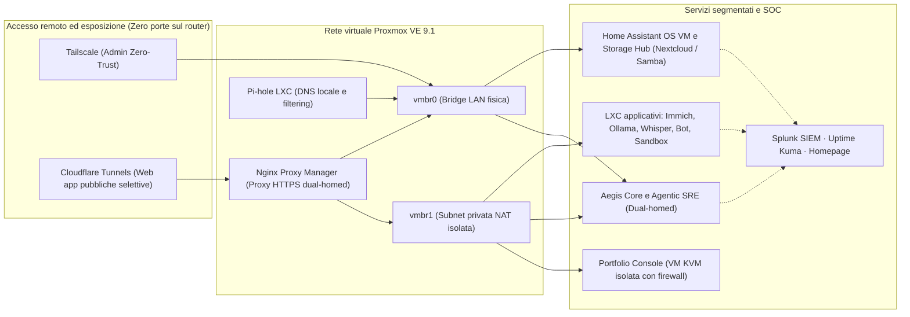
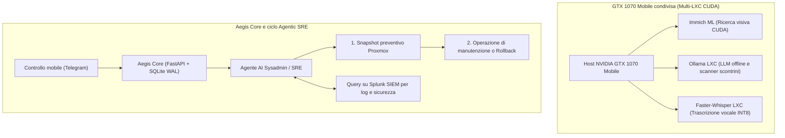

## Perché costruire un homelab se il cloud è a un clic?

Molti concetti di ingegneria infrastrutturale e sicurezza restano astratti finché non gestisci in prima persona servizi reali che usi tutti i giorni: un reverse proxy da mantenere pulito, un budget di RAM stretto da far quadrare, un picco anomalo nei log da indagare. Ho costruito il mio homelab per unire **privacy reale** (alternative self-hosted a cloud foto, drive e assistenti vocali) e **palestra tecnica concreta**, applicando pattern enterprise — segmentazione di rete, SIEM centralizzato, backup snapshot automatici e accesso Zero-Trust — a un'infrastruttura domestica a costo zero.

Invece di acquistare server rack, sono partito da un vincolo che obbliga a progettare con metodo: **riutilizzare in modo sostenibile un laptop gaming ASUS dismesso**, operativo 24/7.

## 1. Hardware, batteria-UPS e storage a 3 livelli

Sul livello bare-metal gira **Proxmox VE 9.1** (kernel **Linux 6.17**) su un laptop ASUS riciclato:

- **Compute:** Intel Core i7-7700HQ (4 core / 8 thread), **16 GB di RAM** e GPU dedicata **NVIDIA GeForce GTX 1070 Mobile**.
- **UPS integrato via software:** tenere un portatile collegato 24/7 al 100% degrada rapidamente la batteria. Ho quindi scritto uno **script custom di battery charge limiting** che limita la carica per preservare le celle e trasforma la batteria in un **UPS integrato**, assorbendo brevi blackout senza spegnimenti bruschi.

Per evitare di mescolare I/O dell'hypervisor, librerie multimediali e backup sullo stesso disco, lo storage è diviso su **tre livelli**:

| Livello | Supporto | Ruolo |
| :--- | :--- | :--- |
| **Tier 1 · Sistema** | SSD 256 GB (`LVM-thin`) | Hypervisor Proxmox VE e dischi root di VM e LXC |
| **Tier 2 · Dati veloci** | SSD 1 TB | Datastore ad alte prestazioni per media e AI (es. Immich) |
| **Tier 3 · Condiviso & DR** | HDD 2 TB | Storage condiviso (Nextcloud / Samba) e target backup automatici |

Ogni notte alle **03:00**, Proxmox esegue backup automatici tramite **`vzdump`** in modalità **snapshot** con compressione **`zstd`** sull'HDD da 2 TB, garantendo ripristini rapidi senza fermare i servizi attivi.

## 2. Segmentazione di rete, ingresso senza porte aperte e SOC

Aprire porte manualmente sul router domestico espone la rete a scansioni continue. L'architettura di rete azzera le porte esposte in ingresso e separa la LAN fisica dai container applicativi:

- **Due bridge virtuali:** `vmbr0` è attestato sulla LAN fisica, mentre `vmbr1` definisce una **subnet privata isolata dietro NAT/masquerade** dedicata ai container applicativi. Solo pochi servizi di raccordo — **Nginx Proxy Manager** e il nodo **Aegis Core** — operano in **dual-homing controllato**.
- **DNS locale e filtro:** un container LXC dedicato con **Pi-hole** gestisce risoluzione DNS interna e blocco di tracker e pubblicità.
- **Accesso remoto e ingress a strati:**
  - **Tailscale** per l'accesso amministrativo e privato Zero-Trust.
  - **Nginx Proxy Manager** per il routing HTTPS interno.
  - **Cloudflare Tunnels** per esporre selettivamente singole web app pubbliche senza aprire nessuna porta sul router.
- **Osservabilità e SOC personale:** **Splunk SIEM** in container dedicato centralizza i log per analisi di sicurezza e troubleshooting, **Uptime Kuma** controlla la disponibilità continua con alerting e **Homepage** raccoglie stato e servizi in un'unica dashboard.

## 3. Far convivere 14 workload in 16 GB di RAM

Gestire **12 container LXC e 2 VM KVM** in soli 16 GB di RAM impone di usare la virtualizzazione completa solo dove serve davvero un kernel o un'appliance dedicata:

1. **Home Assistant OS (VM KVM):** appliance dedicata alla domotica domestica.
2. **Portfolio Console (VM KVM isolata con firewall):** micro-VM dedicata all'infrastruttura del portfolio, separata dal resto del laboratorio.

Tutti gli altri servizi girano in **container LXC** leggeri (con Docker all'interno solo per stack multi-servizio), condividendo il kernel Linux 6.17 dell'host e abbattendo l'overhead di memoria:

- **Cloud privato e media:**
  - **Immich** (stack Docker completo: server, PostgreSQL con `pgvectors`/`vectorchord`, Valkey/Redis e container **Machine Learning accelerato via CUDA**) sull'SSD da 1 TB come alternativa privata a Google Photos.
  - **Storage Hub** con **Nextcloud** (Apache, MariaDB, Redis) e **Samba** sull'HDD da 2 TB per file sharing locale e cloud personale.
- **Applicazioni e bot custom in produzione:**
  - **Social Video Bot:** bot Telegram asincrono in Python (`aiogram 3`, Docker) affiancato da un'istanza locale della Telegram Bot API (gestione file fino a **2 GB zero-copy**), hardening anti-SSRF/anti-DoS e Mini App amministrativa.
  - **Fuorisede:** portale domestico e bot di curation con analisi deterministica dei prezzi, scanner scontrini su Ollama locale, Web GUI e server **MCP (JSON-RPC 2.0)**.
  - **Sandbox e sperimentazione:** container dedicati a staging/test e sperimentazione Python/ML su modelli GBM.

## 4. GPU GTX 1070 condivisa e Agentic Sysadmin (AI-Ops)

Un passthrough PCIe classico verso una singola VM bloccherebbe la GPU su un solo servizio. Condividendo invece la **NVIDIA GTX 1070 Mobile** dell'host verso **più container LXC contemporaneamente**, una singola scheda alimenta tre flussi di inferenza locale privacy-first:

- **Immich ML (CUDA)** per indicizzazione e ricerca semantica sulle librerie fotografiche.
- **Ollama** per inferenza LLM offline e analisi locale di documenti e scontrini (usata da Fuorisede).
- **Faster-Whisper (INT8)** per trascrizione vocale locale senza inviare audio al cloud.

Sul fronte operativo, un LXC dedicato ospita **Aegis Core** — piattaforma personale asincrona (FastAPI + SQLite WAL + integrazione mobile/biometria) progettata con architettura anti-leakage e costo zero — affiancata da un **Agente AI Sysadmin/SRE** controllabile da mobile via Telegram:

- Automatizza la manutenzione ordinaria su Proxmox applicando la regola rigida di **snapshot preventivo e rollback**.
- Interroga direttamente **Splunk SIEM** per accelerare troubleshooting e verifiche di sicurezza sui log dei container.

## Cosa mi ha insegnato operarlo ogni giorno

1. **I vincoli hardware migliorano l'architettura:** 16 GB di RAM costringono a scegliere con consapevolezza dove basta un LXC e dove serve una VM KVM con firewall dedicato.
2. **I pattern enterprise funzionano anche su scala personale:** segmentazione `vmbr0`/`vmbr1`, zero porte esposte sul router, Splunk SIEM, backup `vzdump` notturni e guardrail di snapshot trasformano un portatile riciclato in una piattaforma di apprendimento continuo.
3. **Privacy senza compromessi pratici:** Immich CUDA, Nextcloud/Samba, Ollama e Faster-Whisper permettono di sostituire servizi cloud opachi mantenendo velocità locale e pieno controllo sui dati.

[Scheda tecnica dell'Homelab Proxmox VE](/projects/proj-proxmox-homelab) · [agy-telegram: cockpit mobile per agenti](/projects/proj-agy-telegram)
