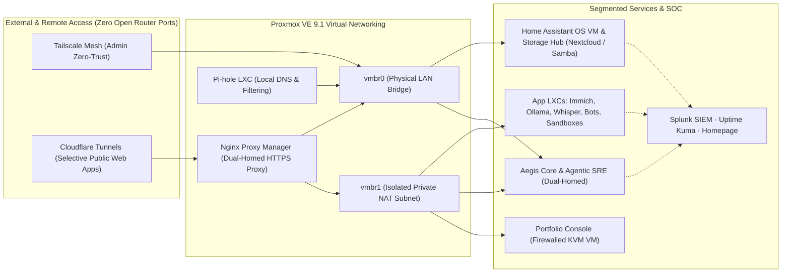
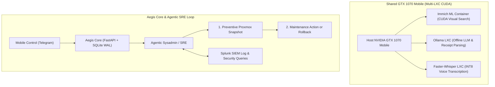

## Why build a homelab when cloud services are one click away?

Most infrastructure lessons stay abstract until you are the one waking up to a broken reverse proxy, tuning a tight memory envelope, or investigating an unexpected log spike. I built my homelab for two overlapping reasons: **privacy** (owning my photos, files, and local voice/document AI) and **engineering practice** — applying real enterprise patterns like network segmentation, centralized SIEM logging, automated snapshot backups, and zero-open-port ingress to services I actually depend on every day.

Instead of buying rackmount hardware, I started with a constraint that forced disciplined architecture: **sustainably repurposing a retired ASUS gaming laptop** to run 24/7.

## 1. Hardware, Power Resilience & Three-Tier Storage

At the bare-metal layer sits an ASUS laptop running **Proxmox VE 9.1** on **Linux kernel 6.17**:

- **Compute:** Intel Core i7-7700HQ (4 cores / 8 threads), **16 GB RAM**, and a dedicated **NVIDIA GeForce GTX 1070 Mobile**.
- **Built-in UPS via software:** Running a laptop 24/7 at 100% battery charge degrades cells quickly. I wrote a custom **battery charge-limiting script** that caps charge to preserve battery health while letting the pack act as an **integrated UPS**, carrying the host smoothly through brief domestic power outages without abrupt filesystem corruption.

To avoid mixing hypervisor I/O, heavy media libraries, and backup traffic on a single disk, storage is split across **three distinct tiers**:

| Tier | Medium | Role |
| :--- | :--- | :--- |
| **Tier 1 · System** | 256 GB SSD (`LVM-thin`) | Proxmox VE hypervisor and VM/LXC root disks |
| **Tier 2 · Hot Data** | 1 TB SSD | High-throughput media and AI datastores (Immich libraries & indexes) |
| **Tier 3 · Shared & DR** | 2 TB HDD | Shared personal storage (Nextcloud / Samba) and automated daily backup target |

Every night at **03:00**, Proxmox executes automated **`vzdump`** jobs in **snapshot mode** with **`zstd` compression** onto the 2 TB HDD — keeping backup windows fast and consistent without shutting down live services.

## 2. Network Segmentation, Zero-Open-Port Ingress & SOC

Exposing a home router with manual port-forwarding turns a private lab into a permanent target for automated scanners. My network design removes inbound router ports entirely while separating physical LAN devices from internal application workloads:

- **Dual-bridge segmentation:** `vmbr0` attaches directly to the physical LAN, while `vmbr1` creates an **isolated private subnet behind NAT/masquerade** for application containers. Only selected control-plane services — specifically **Nginx Proxy Manager** and the **Aegis Core** node — operate in **controlled dual-homing** across both bridges.
- **Local DNS & filtering:** A dedicated **Pi-hole** LXC handles internal DNS resolution and network-wide ad/tracker filtering.
- **Layered remote access:**
  - **Tailscale** provides private Zero-Trust administrative access without exposing management interfaces.
  - **Nginx Proxy Manager** handles internal HTTPS termination and routing.
  - **Cloudflare Tunnels** expose specific public web apps selectively over outbound connections — zero open WAN ports on the domestic router.
- **Observability & personal SOC:** Logs flow into a dedicated **Splunk SIEM** container for security analysis and troubleshooting, **Uptime Kuma** watches continuous service availability and alerts on regressions, and **Homepage** brings health and service links into a single unified dashboard.

## 3. Fitting 14 Workloads Inside 16 GB of RAM

Running **12 LXC containers and 2 KVM virtual machines** simultaneously on 16 GB of RAM is an exercise in avoiding unnecessary virtualization overhead. Full KVM VMs are reserved strictly where kernel isolation or a dedicated appliance OS is required:

1. **Home Assistant OS (KVM VM):** Dedicated smart-home appliance managing domestic automation.
2. **Portfolio Console (Isolated KVM VM with firewall):** Dedicated micro-VM isolating the public portfolio console infrastructure from the rest of the homelab.

Everything else runs in lean **LXC containers** (with Docker nested only where multi-service application stacks benefit from it), sharing the host Linux 6.17 kernel with minimal RAM footprint:

- **Self-Hosted Cloud & Media:**
  - **Immich** (full Docker stack: server, PostgreSQL with `pgvectors`/`vectorchord`, Valkey/Redis, and a **CUDA-accelerated Machine Learning** container) replacing cloud photo libraries on the 1 TB SSD.
  - **Storage Hub** combining **Nextcloud** (Apache, MariaDB, Redis) and **Samba** on the 2 TB HDD for personal cloud sync and LAN file sharing.
- **Custom Production Apps & Bots:**
  - **Social Video Bot:** Asynchronous Python Telegram bot (`aiogram 3`, Docker) paired with a local Telegram Bot API instance supporting **zero-copy file handling up to 2 GB**, hardened against SSRF and DoS, with an administrative Mini App.
  - **Fuorisede:** Household portal and curation bot combining deterministic price analysis, a local Ollama-powered receipt scanner, a Web GUI, and an **MCP (JSON-RPC 2.0)** server.
  - **Sandbox & ML Experimentation:** Dedicated staging/sandbox containers plus Python/ML environments for Gradient Boosting Machine (GBM) experiments.

## 4. Shared GTX 1070 CUDA & Agentic Sysadmin (AI-Ops)

One of the most rewarding architectural trade-offs in the lab is **concurrent GPU sharing**. Passing a GPU exclusively into a single KVM VM locks it to one workload. By sharing the host's **NVIDIA GTX 1070 Mobile** across multiple LXC containers, three distinct privacy-first AI services leverage CUDA hardware acceleration without competing VMs:

- **Immich ML (CUDA)** for local face/object indexing and visual search.
- **Ollama** for offline LLM inference and local document/receipt parsing (used by Fuorisede).
- **Faster-Whisper (INT8)** for fast, privacy-first local voice transcription.

On the operations side, a dedicated LXC hosts **Aegis Core** — an asynchronous personal platform built on **FastAPI**, **SQLite in WAL mode**, and mobile/biometric integration designed around anti-leakage boundaries and zero recurring cloud cost. Paired with it is an **Agentic Sysadmin / SRE** workflow controllable from mobile via Telegram:

- Automates routine Proxmox VE maintenance under a strict **preventive snapshot and rollback rule** (no state-changing action runs without a recoverable snapshot).
- Queries **Splunk SIEM** directly during troubleshooting and security checks to correlate errors or anomalous events across containers.

## Key Architectural Takeaways

1. **Constraints sharpen engineering judgment:** A 16 GB RAM ceiling immediately exposes bloated stacks and teaches where LXC wins over KVM — and where KVM + firewall isolation is non-negotiable.
2. **Defense in depth works at home scale too:** Combining `vmbr0`/`vmbr1` segmentation, Pi-hole DNS, zero open router ports (Tailscale + Cloudflare Tunnels), Splunk SIEM, and daily `vzdump` zstd snapshots turns a single recycled laptop into a realistic operational lab.
3. **Self-hosting is about ownership, not nostalgia:** Running Immich CUDA, Nextcloud/Samba, Ollama, and Faster-Whisper locally replaces third-party data harvesting while keeping latency low and monthly infrastructure bills at zero.

[Proxmox VE Homelab case study](/projects/proj-proxmox-homelab) · [agy-telegram mobile agent cockpit](/projects/proj-agy-telegram)
