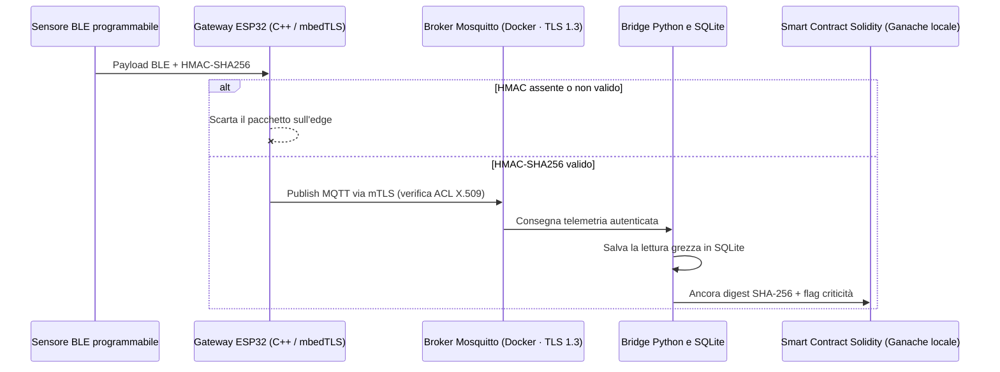

## Una lettura falsa può sembrare del tutto plausibile

Il prototipo originale di CARE raccoglieva misurazioni da sensori biomedicali BLE e le inoltrava al backend su MQTT in chiaro. I sensori venivano riconosciuti solo tramite indirizzo configurato, mentre il client MQTT pubblicava senza TLS né credenziali.

Nella prova di laboratorio all'Università di Salerno, un **ESP32 malevolo** che impersonava un sensore noto è riuscito a iniettare misurazioni fittizie accettate senza errori dalla pipeline. Quell'esperimento ha cambiato la domanda di progetto: *se un valore clinico sembra plausibile e arriva con un'identità familiare, quali prove crittografiche ha davvero ciascuno strato del sistema?*

## Confine 1: verificare il payload BLE prima dell'inoltro

Ho sviluppato il firmware del gateway ESP32 in **C++ (PlatformIO, mbedTLS)** in modo che verifichi un tag **HMAC-SHA256** su ogni lettura BLE *prima* di passarla al client MQTT. Qualsiasi pacchetto con firma assente o non valida viene scartato direttamente sull'edge.

Questa scelta comporta un vincolo concreto: la verifica HMAC richiede un **sensore BLE programmabile** capace di generare il payload firmato. Molti dispositivi biomedicali commerciali sono chiusi e non permettono firmware custom; in un contesto clinico reale, quindi, questo livello richiede sensori programmabili (come Movesense MD) oppure meccanismi di sicurezza BLE a livello di pairing.

## Confine 2: mTLS (TLS 1.3) e ACL per topic su certificati X.509

Proteggere il payload BLE non basta se il canale verso il broker resta aperto. Ho configurato **Mosquitto in Docker** con **mTLS (TLS 1.3)**, assegnando **certificati client X.509 distinti** al gateway ESP32 e al bridge Python di ingestione.

Mosquitto lega direttamente l'identità del certificato alle **ACL sui topic MQTT**:
- il gateway può pubblicare *solo* sui propri topic di telemetria;
- il bridge di ingestione ha permessi di sola sottoscrizione su quei topic.

I due controlli non sono ridondanti: **mTLS dimostra quale gateway ha aperto la connessione**, mentre **l'HMAC sull'edge verifica che la lettura provenga davvero dal sensore autorizzato** e non da uno spoofer BLE nella stanza.

## Confine 3: rilevare alterazioni dello storico (e i suoi limiti)

Dopo aver salvato la lettura in **SQLite**, il bridge Python calcola un **digest SHA-256** e lo registra (senza mai scrivere dati clinici in chiaro) in uno **smart contract Solidity su rete locale Ganache**.

In fase di audit è possibile ricalcolare gli hash dal database e confrontarli con i digest ancorati per individuare eventuali alterazioni dello storico. Conviene però restare lucidi su cosa garantisce davvero questo strato:
- l'ancoraggio **rende rilevabili modifiche successive al database**, ma *non* impedisce l'ingresso di dati falsi se mancano i controlli a monte;
- introduce il costo di una transazione nel flusso di persistenza, utile solo quando l'audit richiede un riferimento di integrità separato dal database applicativo.

[Architettura, codice e demo del gateway](/projects/proj-mtls-iot-gateway)
