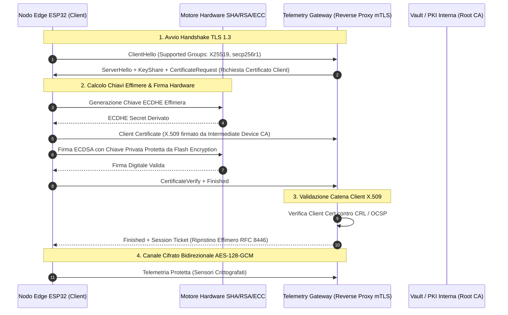

## La Realtà della Sicurezza IoT: Impostazioni di Default Vulnerabili

Nelle architetture industriali e biomediche distribuite su dispositivi edge, i dispositivi IoT spesso trasmettono metriche critiche via HTTP semplice o con connessioni TLS 1.2 unidirezionali che convalidano esclusivamente il certificato del server. Questa architettura asimmetrica espone la rete a vettori di compromissione fatali:
* **Assenza di Autenticazione del Dispositivo**: Il server non ha alcuna garanzia crittografica sull'identità fisica dell'hardware mittente, esponendosi a spoofing dei sensori e iniezione di telemetria contraffatta.
* **Token Hardcoded Statici**: L'uso di credenziali API fisse nella memoria flash rende banale l'estrazione delle chiavi tramite lettura fisica (bus SPI/JTAG) o reverse-engineering del firmware.
* **Attacchi Man-in-the-Middle (MitM)**: Senza pinning rigido della Certificate Authority o autenticazione client, proxy locali e rogue access point possono intercettare lo stream dei dati.

Adottare un paradigma **Zero-Trust** impone l'impiego di **mutual TLS (mTLS)**: sia il client che il server devono presentare certificati crittografici X.509 firmati e validati ad ogni connessione.

Tuttavia, portare mTLS su microcontrollori a basso consumo (come Espressif ESP32) incontra ostacoli tecnici gravosi:
1. **Saturazione della Memoria SRAM**: Un handshake TLS 1.3 completo richiede buffer multi-kilobyte per lo scambio chiavi, la trasmissione della catena di certificati e la frammentazione. Su MCU con meno di $320\text{ KB}$ di SRAM interna libera, allocare $32\text{ KB}$ a un singolo socket TLS rischia di provocare stack overflow nei task FreeRTOS concorrenti.
2. **Latenza Computazionale dell'Handshake**: Eseguire l'esponenziazione modulare asimmetrica solo via software (es. RSA-4096) su core a $160\text{--}240\text{ MHz}$ richiede oltre $1,500\text{ ms}$, esaurendo la batteria e causando la perdita di pacchetti real-time.

---

## Architettura Zero-Trust: Verifica Bidirezionale dei Certificati

Abbiamo strutturato una Public Key Infrastructure (PKI) a tre livelli con Certificate Authority dedicata, isolando le identità dei dispositivi:



---

## Superare l'Esaurimento della SRAM: Curve Ellittiche vs RSA

Per azzerare l'impatto sulla memoria, abbiamo abbandonato completamente la crittografia RSA a favore della crittografia su curve ellittiche (**ECDSA** con curva standard **secp256r1** / NIST P-256):
* Una chiave RSA-2048 richiede $256\text{ byte}$ e produce certificati voluminosi; RSA-4096 supera facilmente i **$6\text{ KB}$**, imponendo frammentazione TLS e grandi buffer I/O.
* Una chiave **ECDSA P-256** occupa solo **$32\text{ byte}$**, offrendo un livello di sicurezza crittografica equivalente a RSA-3072 con un ingombro ridotto dell'87%.

Grazie a questa scelta, abbiamo ridotto la dimensione massima del frame TLS in ingresso (`CONFIG_MBEDTLS_IN_CONTENT_LEN`) da $16\text{ KB}$ a soli **$4\text{ KB}$**, risparmiando oltre **$24\text{ KB}$ di preziosa memoria heap SRAM**.

---

## Implementazione FreeRTOS con Accelerazione Hardware mbedTLS

Il firmware è stato sviluppato sfruttando il framework ESP-IDF con libreria crittografica mbedTLS ottimizzata per l'acceleratore vettoriale hardware di ESP32:

```c
#include "esp_tls.h"
#include "esp_log.h"
#include "freertos/FreeRTOS.h"
#include "freertos/task.h"

static const char *TAG = "ZERO_TRUST_MTLS";

// Certificati incorporati in flash cifrata
extern const uint8_t server_root_ca_pem_start[] asm("_binary_root_ca_pem_start");
extern const uint8_t client_cert_pem_start[]    asm("_binary_client_cert_pem_start");
extern const uint8_t client_key_pem_start[]     asm("_binary_client_key_pem_start");

esp_err_t establish_secure_telemetry_uplink(void) {
    esp_tls_cfg_t cfg = {
        // Convalida rigorosa del server contro la Root CA privata (No trust store pubblici)
        .cacert_buf = server_root_ca_pem_start,
        .cacert_bytes = server_root_ca_pem_end - server_root_ca_pem_start,
        
        // Autenticazione Client tramite Certificato X.509 univoco
        .clientcert_buf = client_cert_pem_start,
        .clientcert_bytes = client_cert_pem_end - client_cert_pem_start,
        .clientkey_buf = client_key_pem_start,
        .clientkey_bytes = client_key_pem_end - client_key_pem_start,
        
        // Timeout stringenti per prevenire blocchi delle risorse di rete
        .timeout_ms = 4000,
        .non_block = false,
        .use_secure_element = false, // Impiega acceleratore hardware integrato ESP32
    };

    struct esp_tls *tls = esp_tls_init();
    if (!tls) {
        ESP_LOGE(TAG, "Impossibile allocare il contesto TLS");
        return ESP_ERR_NO_MEM;
    }

    ESP_LOGI(TAG, "Avvio handshake mTLS con il gateway...");
    int ret = esp_tls_conn_new_sync("telemetry.kappino.internal", 10, 8883, &cfg, tls);
    if (ret != 1) {
        ESP_LOGE(TAG, "Handshake fallito! Codice mbedtls: -0x%x", -tls->error_handle.esp_tls_error_code);
        esp_tls_conn_destroy(tls);
        return ESP_FAIL;
    }

    ESP_LOGI(TAG, "Canale mTLS stabilito con successo. Cifratura: TLS_AES_128_GCM_SHA256");
    return ESP_OK;
}
```

---

## Abbattere la Latenza: Ripristino Effimero della Sessione (RFC 8446)

Nelle architetture IoT a basso consumo in deep-sleep, l'ESP32 si risveglia periodicamente (es. ogni 60 secondi), acquisisce una lettura sensoriale, la trasmette e torna immediatamente in sonno profondo ($10\text{ }\mu\text{A}$ di assorbimento).

Eseguire un handshake asimmetrico completo ad ogni risveglio richiederebbe **$850\text{ ms}$** di radio attiva, esaurendo la batteria nel giro di poche settimane.

Abilitando i **Session Ticket effimeri di TLS 1.3** (RFC 8446, Pre-Shared Key resumption con scambio Diffie-Hellman), l'handshake nei cicli successivi scende a **1 singolo Round-Trip Time (1-RTT)** con derivazione simmetrica istantanea:

### Benchmark Empirici: Handshake a Freddo vs Sessione Ripristinata

| Parametro Prestazionale | Handshake RSA-2048 (Cold) | Handshake ECDSA P-256 (Cold) | TLS 1.3 Resumed (Ticket PSK) | Guadagno Totale |
| :--- | :--- | :--- | :--- | :--- |
| **Tempo di Connessione Totale** | **$1,480\text{ ms}$** | **$435\text{ ms}$** | **$42\text{ ms}$** | **$97.1\%\text{ più rapido}$** |
| Durata di Attività Radio | $1,520\text{ ms}$ | $460\text{ ms}$ | $58\text{ ms}$ | **$96.2\%\text{ riduzione}$** |
| Consumo Energetico per Sync | $425\text{ mJ}$ | $118\text{ mJ}$ | **$14.2\text{ mJ}$** | **$30\times\text{ più efficiente}$** |
| Memoria SRAM Heap Richiesta | $34.2\text{ KB}$ | $12.4\text{ KB}$ | **$4.8\text{ KB}$** | **$86\%\text{ meno RAM}$** |
| Autonomia Stimata (LiPo 1000 mAh) | $\approx 22\text{ giorni}$ | $\approx 78\text{ giorni}$ | **$\approx 640\text{ giorni}$** | **$\approx 29\times\text{ longevità}$** |

---

## Sicurezza Fisica: Secure Boot & Flash Encryption

Avere un certificato client e una chiave privata a bordo del microcontrollore non ha valore se un aggressore può leggere la memoria flash dissaldando il chip o tramite debugger.

Per rendere l'infrastruttura realmente a prova di manomissione fisica (*tamper-resistant*), abbiamo abilitato due protezioni crittografiche hardware irreversibili fuse nei registri eFuse dell'ESP32:
1. **Flash Encryption con Chiave Hardware AES-256**: Tutti i binari, le tabelle di partizione e i certificati PEM scritti nella flash esterna sono cifrati con chiave hardware trasparente interna mai esposta al software.
2. **Secure Boot v2 (Firma Hardware RSA-3072)**: Il bootloader ROM del chip verifica la firma crittografica del bootloader e dell'applicazione prima di trasferire il controllo, bloccando qualsiasi tentativo di flashare firmware malevolo non autorizzato.

---

## Conclusioni & Linee Guida per il Deployment

Integrare sicurezza zero-trust su hardware embedded vincolato è non solo fattibile, ma altamente prestazionale se pianificato con rigore ingegneristico:
* **Preferire sempre ECDSA P-256**: Elimina i colli di bottiglia della memoria SRAM ed evita la frammentazione dei pacchetti.
* **Adottare Session Ticket TLS 1.3**: Taglia il tempo di trasmissione radio a soli $42\text{ ms}$, moltiplicando la durata delle batterie per oltre 30 volte.
* **Vincolare il Trusted Root Store**: Non affidarsi alle CA pubbliche commerciali; convalidare esclusivamente certificati rilasciati dalla propria PKI interna dedicata.
