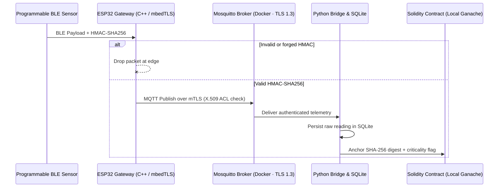

## A forged reading can look completely plausible

The original CARE prototype collected biomedical readings from BLE sensors and forwarded them to a backend over plaintext MQTT. Sensors were matched only by configured addresses, and MQTT publishing carried neither TLS nor client credentials.

In our lab test at the University of Salerno, a **rogue ESP32** impersonating a known sensor injected forged readings straight into the pipeline — and the gateway forwarded them without hesitation. That single demo reframed the entire engineering question: *if a reading looks numerically plausible and arrives under a familiar address, what cryptographic evidence does each layer actually hold?*

## Boundary 1: Verify the BLE payload before it leaves the edge

I wrote the ESP32 gateway firmware in **C++ (PlatformIO, mbedTLS)** to validate an **HMAC-SHA256** authentication tag on every incoming BLE payload *before* touching the MQTT client. Any payload with a missing or invalid tag is dropped immediately at the edge.

This choice comes with an honest hardware trade-off: checking an HMAC requires a **programmable BLE sender** capable of signing payloads in the expected format. Many off-the-shelf clinical wearables do not allow custom firmware, so in a real hospital deployment this boundary either demands programmable sensors (such as Movesense MD) or pairing-level BLE security where custom signing is impossible.

## Boundary 2: Mutual TLS (TLS 1.3) and X.509 topic ACLs

Authenticating the sensor payload still leaves the network hop exposed. To lock down broker access, I containerized **Mosquitto (Docker)** with **mTLS (TLS 1.3)** and issued distinct **X.509 client certificates** for the ESP32 gateway and the Python ingestion bridge.

Mosquitto maps each certificate's identity directly to **MQTT topic ACLs**:
- The gateway certificate is allowed to publish *only* to its designated telemetry topics.
- The ingestion bridge holds read-only subscription permissions on those topics.

Notice why both layers matter: **mTLS proves which gateway opened the TCP connection**, whereas **edge HMAC proves the reading itself came from an authorized sender** rather than a nearby BLE spoofer.

## Boundary 3: Post-storage tamper detection (and its limits)

Once the Python bridge persists a clinical reading in **SQLite**, it computes a **SHA-256 digest** and anchors that digest (alongside audit metadata, never raw clinical payloads) in a **Solidity smart contract on a local Ganache network**.

Later, an auditor can recompute hashes from SQLite and compare them against the anchored digests to detect whether historical rows were altered. Keeping expectations grounded is essential here:
- Digest anchoring **detects post-storage tampering**; it does *not* prevent forged data from entering the system if upstream checks fail.
- Anchoring introduces transaction latency into persistence — worth keeping only when audit requirements demand an integrity reference independent of the application database.

[Gateway architecture, code & lab demo](/projects/proj-mtls-iot-gateway)
